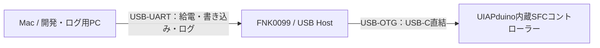

# FNK0099 USB Host — SFCコントローラー入力

**Freenove FNK0099 USB-C OTG host tested — no additional power supply or hardware modifications required.**

Tested with a UIAPduino-based SNES controller acting as a USB HID keyboard. The FNK0099 was powered through its USB-UART port, with the controller connected directly to its USB-OTG port via a USB-C cable.

Freenove FNK0099（ESP32-S3-WROOM Board Lite）で、[UIAPduino内蔵SFCコントローラー](https://github.com/otitbridge/snes-controller-uiapduino)のUSB HIDキーボード入力を受信し、12ボタンの状態をUARTへ出力するファームウェアです。

既設USB-OTG端子へのUSB-C直結で動作確認済みです。追加給電・USBハブ・基板改造は使用していません。エミュレーターや無線送信機能は含みません。

## 接続構成



| 必要なもの | 動作確認した構成 |
|---|---|
| Hostボード | FNK0099 Rev 1.1、N16R8（16MB Flash / 8MB PSRAM） |
| コントローラー | UIAPduino V1.4、USBキーボード版 v1.0.0（SELECT→Tab） |
| OTG側ケーブル | AT-PDCASTCC08、コントローラーに内蔵 |
| 開発環境 | Mac、PlatformIO Core、USB-UART通信ケーブル |

PSRAMは現行ファームでは使用しません。別の基板Rev・ケーブル・OSでの動作は個別に確認してください。

## 使い方

1. FNK0099の**USB-UART端子**を開発PCにつなぎます。
2. [ビルド・書き込み手順](docs/build.md)に従ってファームを書き込み、115200 baudでUARTを開きます。
3. SFCの全ボタンを離し、ケーブルをFNK0099の**USB-OTG端子**へ直接接続します。
4. `1209:d004`、`keyboard start: ESP_OK`、`SFC mask` のログを確認します。

次は右＋BからBだけを離した場合の出力形式例です。時刻と他のログは省略しています。

```text
RAW: 00 00 1d 4f 00 00 00 00
SFC mask=0x081 changed=0x081 reason=report
RAW: 00 00 4f 00 00 00 00 00
SFC mask=0x080 changed=0x001 reason=report
```

マスクのbit 0〜11は **B・Y・SELECT・START・上・下・左・右・A・X・L・R** に対応し、押下中が1です。`changed` は前回との差分（XOR）です。同一レポートの繰り返し出力は省略します。

## 確認済みの動作と制約

12ボタン、左右30秒以上の保持、3入力同時押しと部分解放、切断時の全解放、再接続3回、RESET再起動3回を確認済みです。給電を切って戻す試験とHost側USB-Cの反転も確認しています。詳細な条件は[検証結果](docs/validation.md)をご覧ください。

- 受信対象は `1209:D004` のキーボードIF1です。汎用ゲームパッド用ではありません。
- 元のキーボード版は最大6入力です。送られていない7個目以降の入力は復元できません。
- 抜去時のEP／URBログは**軽微（暫定）**。原因未確定ですが、修正後の試験では再接続・入力復帰を確認しています。
- **30分連続稼働試験は保留・未完了**です。

[既知の制約・問題の切り分け](docs/known-issues.md)に、未確認項目と重要度を見直す条件をまとめています。

## 関連資料

- [ビルド・書き込み・ログ取得](docs/build.md)
- [検証結果と試験経緯](docs/validation.md)
- [既知の制約・問題の切り分け](docs/known-issues.md)
- [証跡一覧](docs/evidence/README.md)
- [事前調査と設計方針](docs/design-notes.md)
- [Freenove公式資料](https://docs.freenove.com/projects/fnk0099/en/latest/)
